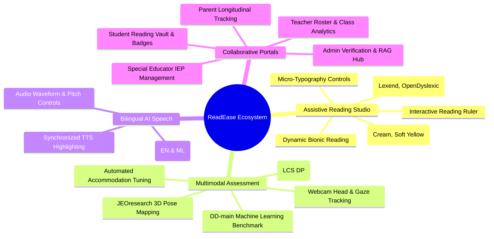
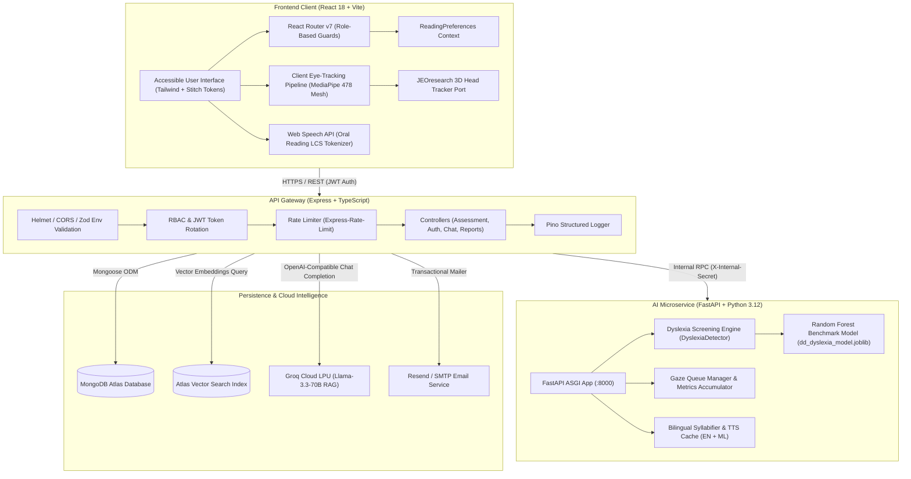
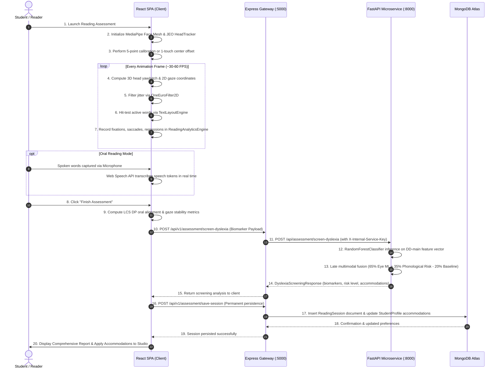
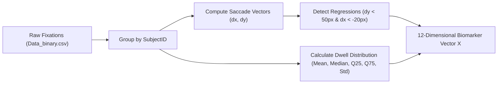
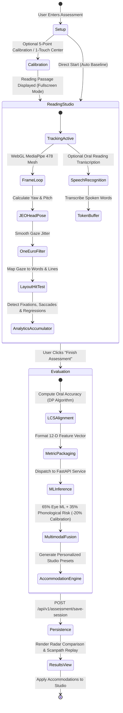
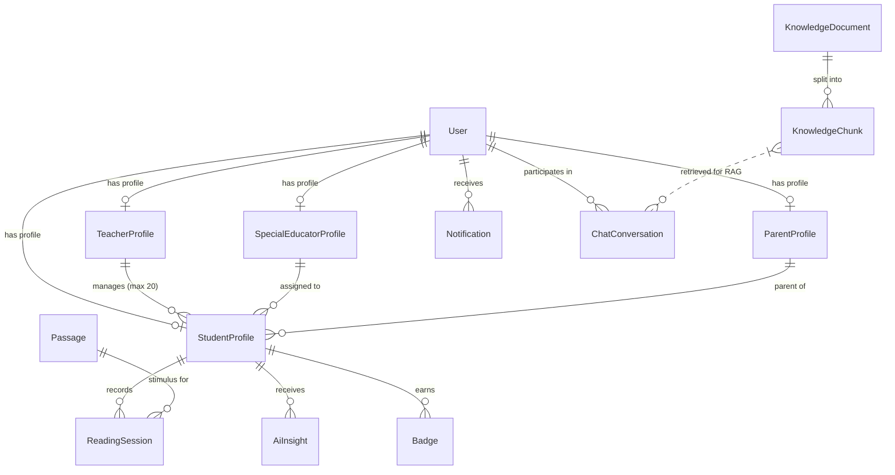

# 📖 ReadEase — Complete Project Documentation

> **Document Version**: 2.0.0  
> **Last Updated**: October 2026  
> **Classification**: Technical Project Report / Architecture & Implementation Specification  
> **Repository**: `srjofficial/ReadEase`  
> **Workspace**: `C:\Users\saroj\projects\ReadEase`

---

## 📑 Table of Contents

1. [Project Overview](#1-project-overview)
2. [Tech Stack](#2-tech-stack)
3. [System Architecture](#3-system-architecture)
4. [Datasets & Machine Learning Benchmarks](#4-datasets--machine-learning-benchmarks)
5. [Reading Assessment Implementation](#5-reading-assessment-implementation)
6. [Database Design & Data Models](#6-database-design--data-models)
7. [Implementation Plan & Progress](#7-implementation-plan--progress)
8. [Testing and Validation](#8-testing-and-validation)
9. [Challenges and Solutions](#9-challenges-and-solutions)
10. [Future Enhancements](#10-future-enhancements)
11. [Setup and Run Instructions](#11-setup-and-run-instructions)
12. [Gaps and Assumptions](#12-gaps-and-assumptions)

---

## 1. Project Overview

### 1.1 Problem Statement

Reading is the primary gateway to education, vocational autonomy, and personal development. However, individuals with dyslexia, Attention Deficit Hyperactivity Disorder (ADHD), Meares-Irlen syndrome (visual stress), and broader neurodivergent profiles encounter severe cognitive and visual friction when engaging with standard digital and print text:

- **Visual Crowding & Line Skipping**: Inability of the oculomotor system to maintain stable saccadic fixation trajectories, leading to unintentional line skipping, backward saccadic regressions, and cognitive exhaustion.
- **Phonological Decoding Barriers**: Deficits in rapid grapheme-to-phoneme conversion that trigger severe hesitation, word mispronunciation, and diminished reading comprehension.
- **Visual Glare & Contrast Fatigue**: High-contrast black-on-white digital displays induce visual stress, word vibration ("swimming text"), and headaches for readers with Meares-Irlen syndrome.
- **Prohibitive Assessment Barriers**: Clinical dyslexia and reading assessments traditionally require expensive specialized infrared hardware (e.g., Tobii eye trackers costing thousands of dollars) and qualified neuropsychologists, rendering early screening inaccessible to low-resource schools and home environments.
- **Fragmented Stakeholder Communication**: Students, classroom teachers, special educators, and parents work in informational silos without a unified platform for tracking Individualized Education Programs (IEPs), reading stamina, and real-time accommodations.

### 1.2 Objectives

**ReadEase** is engineered as an enterprise-grade, accessible reading and assistive learning ecosystem designed to eliminate these barriers through cognitive-first software interventions:

1. **Democratize Early Reading Assessment**: Deliver an objective, webcam-based multimodal reading assessment that evaluates oculomotor biomarkers (fixations, saccades, regressions) and oral speech telemetry against verified clinical datasets—operating on standard consumer laptops without specialized eye-tracking hardware.
2. **Cognitive-First Real-Time Accommodations**: Provide real-time dynamic Bionic Reading fixation anchors, research-backed dyslexia typefaces, tactile reading rulers, and warm contrast canvases that readers can personalize to their unique visual profile.
3. **Bilingual Phonemic Assistance**: Deliver automated syllable segmentation, phonemic breakdowns, and synchronized text-to-speech for both **English** and **Malayalam**, supporting regional linguistics and multilingual learners.
4. **Collaborative Multi-Role Ecosystem**: Provide dedicated, secure role-based portals for Students, Teachers, Special Educators, Parents, and Administrators to monitor reading growth, assign passages, track IEP goals, and share longitudinal insights.
5. **Ethical, Non-Diagnostic AI Guidance**: Implement transparent, scientifically calibrated machine learning models that deliver clear educational screening observations while strictly disclaiming clinical diagnosis.

### 1.3 Target Users

| Role                 | Primary Objectives & Workflow                                                                                                                                           | Key Interfaces                                                                        |
| :------------------- | :---------------------------------------------------------------------------------------------------------------------------------------------------------------------- | :------------------------------------------------------------------------------------ |
| **Student / Reader** | Overcome visual stress, engage in daily reading practice, complete multimodal assessments, earn achievement badges, customize reading studio preferences.               | `/student/dashboard`, `/student/assessment`, `/student/studio`, `/student/customizer` |
| **Teacher**          | Oversee classroom cohorts (capped at 20 active students per policy), assign leveled reading passages, review aggregate class fluency reports, invite special educators. | `/teacher/dashboard`, `/teacher/students`, `/teacher/assessments`, `/teacher/reports` |
| **Special Educator** | Track assigned students with diagnosed or at-risk reading challenges, formulate and monitor Individualized Education Plans (IEPs), record clinical session notes.       | `/educator/dashboard`, `/educator/students`, `/educator/plans`, `/educator/reports`   |
| **Parent**           | Monitor child's reading frequency, view weekly oral reading stamina trends, celebrate milestone achievements, access home practice guides.                              | `/parent/dashboard`, `/parent/progress`, `/parent/sessions`, `/parent/alerts`         |
| **System Admin**     | Verify educator credentials, review system telemetry, curate RAG knowledge base documents, configure AI microservices and audit logs.                                   | `/admin/dashboard`, `/admin/verification`, `/admin/rag`, `/admin/analytics`           |

### 1.4 Key Features



- **Dynamic Bionic Reading Engine**: Algorithmically bolds the initial phonemes (30% to 70% fixation weight) of words to guide the eye across saccadic jumps, drastically reducing reading time and word skips.
- **Dyslexia-Optimized Type Scale**: Curated typography system integrating **Lexend**, **Atkinson Hyperlegible**, and **OpenDyslexic** with adjustable letter spacing, word spacing, and line height.
- **Tactile Reading Ruler & Visual Overlays**: A draggable, height-adjustable on-screen reading guide that isolates active lines and masks peripheral visual noise.
- **Zero-Hardware Webcam Reading Assessment**: Uses MediaPipe Face Mesh and a ported 3D Head Tracker to detect fixations, regressions, and line transitions directly in the browser.
- **Multimodal Dyslexia Screening**: Fuses eye-movement metrics with oral speech analysis (speech rate, hesitation density, phonological fluency) evaluated against the 4,298-subject **DD-main** scientific dataset.
- **Bilingual English & Malayalam Engine**: Syllabification and speech synchronization engineered specifically for complex Malayalam conjunct characters as well as English phonetics.
- **RAG-Powered Assistive Chatbot**: Role-scoped Retrieval-Augmented Generation using Groq Llama-3.3-70B and MongoDB Atlas Vector Search for answering pedagogical and accommodation inquiries.

---

## 2. Tech Stack

Every technology in the ReadEase monorepo is specified below with its exact version extracted from root and workspace configuration files, along with its specific architectural purpose.

### 2.1 Monorepo & Tooling Baseline

| Tool / Dependency  | Version   | Workspace / File       | Architectural Rationale                                                                                 |
| :----------------- | :-------- | :--------------------- | :------------------------------------------------------------------------------------------------------ |
| **Node.js**        | `>=20.x`  | Monorepo Runtime       | Native fetch support, performance optimizations, and LTS stability.                                     |
| **npm Workspaces** | `>=10.x`  | `package.json`         | Orchestrates multi-package monorepo (`packages/*`, `client`, `server`) with zero symlink drift.         |
| **TypeScript**     | `^5.4.5`  | Root & Sub-packages    | Strict static typing (`noImplicitAny`, `strictNullChecks`) across client, server, and shared contracts. |
| **ESLint**         | `^8.57.0` | `eslint.config.js`     | Enforces corporate code quality and accessibility linting rules across all workspaces.                  |
| **Prettier**       | `^3.2.5`  | `.prettierrc.json`     | Enforces uniform code formatting across TypeScript, CSS, and Markdown.                                  |
| **Husky**          | `^9.0.11` | `.husky/`              | Manages Git pre-commit hooks to guarantee code quality prior to version control commits.                |
| **Lint-Staged**    | `^15.2.2` | `.lintstagedrc.json`   | Runs linter, type-check, and formatters strictly against staged files for ultra-fast commits.           |
| **Commitlint**     | `^19.3.0` | `commitlint.config.js` | Enforces Conventional Commits (`feat:`, `fix:`, `docs:`, `chore:`) across contributor branches.         |
| **Concurrently**   | `^10.0.5` | `package.json`         | Runs client Vite dev server and server Express backend concurrently in a single terminal.               |

### 2.2 Frontend Client (`client/`)

| Library / Tool              | Version                | File Reference              | Architectural Rationale                                                                        |
| :-------------------------- | :--------------------- | :-------------------------- | :--------------------------------------------------------------------------------------------- |
| **React**                   | `^18.3.1`              | `client/package.json`       | Modern declarative component architecture, concurrent rendering, and fine-grained hooks.       |
| **React DOM**               | `^18.3.1`              | `client/package.json`       | Virtual DOM reconciliation and browser mount target.                                           |
| **Vite**                    | `^5.2.11`              | `client/vite.config.ts`     | Lightning-fast ESM development bundler and optimized Rollup production packager.               |
| **React Router DOM**        | `^7.18.4`              | `client/package.json`       | Declarative routing, nested layouts, role-based route guards, and code-split suspense loading. |
| **TailwindCSS**             | `^3.4.3`               | `client/tailwind.config.ts` | Utility-first design token styling implementing the Google Stitch accessible palette.          |
| **PostCSS / Autoprefixer**  | `^8.4.38` / `^10.4.19` | `client/package.json`       | Automated cross-browser CSS vendor prefixing and transformations.                              |
| **Lucide React**            | `^0.378.0`             | `client/package.json`       | Lightweight, WCAG-compliant accessible SVG icons with zero layout shift.                       |
| **@mediapipe/face_mesh**    | `^0.4.1633559619`      | `client/package.json`       | Real-time 478-point 3D facial landmark detection running client-side via WebGL/WebAssembly.    |
| **@mediapipe/camera_utils** | `^0.3.1675466862`      | `client/package.json`       | Efficient browser webcam stream acquisition and frame dispatching loop.                        |
| **pdfjs-dist**              | `^3.11.174`            | `client/package.json`       | In-browser parsing and structured text extraction from uploaded PDF documents.                 |
| **Mammoth**                 | `^1.13.0`              | `client/package.json`       | Converts `.docx` documents into clean semantic HTML without style clutter.                     |

### 2.3 Backend API Gateway (`server/`)

| Library / Tool          | Version               | File Reference               | Architectural Rationale                                                                     |
| :---------------------- | :-------------------- | :--------------------------- | :------------------------------------------------------------------------------------------ |
| **Express**             | `^4.19.2`             | `server/package.json`        | Minimalist, high-throughput REST API gateway and routing framework.                         |
| **Mongoose**            | `^9.10.0`             | `server/package.json`        | ODM persistence layer for MongoDB with schema validation, transactions, and indexing.       |
| **Zod**                 | `^3.23.8`             | `server/src/config/env.ts`   | Fail-fast runtime environment variable validation and type-safe API schema contracts.       |
| **JSONWebToken**        | `^9.0.3`              | `server/package.json`        | Secure token-based stateless authentication (15m access token + 7d refresh token rotation). |
| **Bcrypt**              | `^6.0.0`              | `server/package.json`        | Industry-standard password hashing using cost factor 12 for brute-force resistance.         |
| **Helmet**              | `^7.1.0`              | `server/src/index.ts`        | Sets secure HTTP headers (CSP, HSTS, X-Content-Type-Options, Frameguard).                   |
| **CORS**                | `^2.8.5`              | `server/src/index.ts`        | Restricts cross-origin resource sharing strictly to configured frontend domains.            |
| **Express Rate Limit**  | `^8.7.0`              | `server/src/index.ts`        | Protects authentication endpoints and API routes against brute-force and DDoS abuse.        |
| **Compression**         | `^1.8.2`              | `server/src/index.ts`        | Gzip/Brotli payload compression to optimize network transfer speeds.                        |
| **Pino & Pino-HTTP**    | `^10.3.1` / `^11.0.0` | `server/src/utils/logger.ts` | High-speed structured JSON logging for production observability and audit trails.           |
| **Nodemailer**          | `^10.0.10`            | `server/src/services/email/` | SMTP transactional email transport for password resets and verification tokens.             |
| **Google Auth Library** | `^11.1.0`             | `server/package.json`        | Verifies Google OAuth 2.0 OpenID Connect tokens on social login flows.                      |
| **TSX**                 | `^4.9.3`              | `server/package.json`        | High-speed TypeScript execution engine for server development hot-reloading.                |

### 2.4 AI, Computer Vision & Screening Microservice (`ai-service/`)

| Package / Tool   | Version         | File Reference                | Architectural Rationale                                                                     |
| :--------------- | :-------------- | :---------------------------- | :------------------------------------------------------------------------------------------ |
| **Python**       | `3.11+ / 3.12`  | Runtime Environment           | Scientific computing runtime supporting Scikit-Learn, NumPy, and MediaPipe.                 |
| **FastAPI**      | `0.111.0`       | `ai-service/requirements.txt` | High-performance asynchronous microservice framework with automatic OpenAPI documentation.  |
| **Uvicorn**      | `0.29.0`        | `ai-service/requirements.txt` | Lightning-fast ASGI web server implementation using `uvloop` and `httptools`.               |
| **Pydantic**     | `2.7.1`         | `ai-service/requirements.txt` | High-performance data validation and serialization for microservice schemas.                |
| **Pillow (PIL)** | `10.3.0`        | `ai-service/requirements.txt` | Image preprocessing, format conversion, and frame decoding for OCR pipelines.               |
| **PyTesseract**  | `0.3.10`        | `ai-service/requirements.txt` | Optical Character Recognition (OCR) wrapper for extracting text from scanned pages.         |
| **PyPDF**        | `4.2.0`         | `ai-service/requirements.txt` | Extracts textual content and metadata from academic PDF reading materials.                  |
| **Scikit-Learn** | `1.4+ (joblib)` | `dyslexia_trainer.py`         | Trains and evaluates Random Forest classifiers on clinical eye-tracking biomarker datasets. |
| **NumPy**        | `1.26+`         | `dyslexia_detector.py`        | Vectorized numerical operations for biomarker feature extraction and spatial statistics.    |
| **Joblib**       | `1.4+`          | `dyslexia_detector.py`        | High-efficiency model serialization and loading for `dd_dyslexia_model.joblib`.             |
| **Pytest**       | `8.2.0`         | `ai-service/requirements.txt` | Automated test suite execution for gaze estimation, scoring, and TTS endpoints.             |

### 2.5 External Services & Cloud APIs

| Service                   | Protocol / Model                          | Purpose                                                                                   |
| :------------------------ | :---------------------------------------- | :---------------------------------------------------------------------------------------- |
| **MongoDB Atlas**         | MongoDB Wire Protocol                     | Managed cloud document database storing users, profiles, sessions, and vector embeddings. |
| **Atlas Vector Search**   | Hierarchical Navigable Small World (HNSW) | Dense vector semantic search indexing for RAG knowledge documents.                        |
| **Groq LPU Inference**    | REST API (`llama-3.3-70b-versatile`)      | Ultra-fast token generation for role-aware assistive chatbot and reading explanations.    |
| **Resend / SMTP**         | REST / TLS SMTP                           | Transactional email delivery for account verification and teacher onboarding.             |
| **Google Cloud Identity** | OAuth 2.0 / OpenID Connect                | Single-Sign-On authentication for students and educators.                                 |

---

## 3. System Architecture

### 3.1 High-Level Architecture Diagram



### 3.2 Folder and Module Structure

```
ReadEase/
├── client/                               # React 18 + TypeScript + Vite Frontend SPA
│   ├── public/                           # Static assets, favicon, manifest
│   ├── src/
│   │   ├── components/                   # Reusable accessible UI components
│   │   │   ├── assessment/               # FaceMeshOverlay, CalibrationView, ScanpathReplay
│   │   │   ├── auth/                     # Role-based Login and Register modal dialogs
│   │   │   ├── navigation/               # Navbar, Sidebar, TopBar, and Footer shells
│   │   │   └── ui/                       # Accessible Button, Card, Input, Modal, Badge, Disclaimer
│   │   ├── context/                      # ReadingPreferencesContext & AuthContext state providers
│   │   ├── eye-tracking/                 # Client-side computer vision & behavioral analytics
│   │   │   ├── analysis/                 # Fixation, Saccade, Regression, Line, & Layout engines
│   │   │   ├── calibration/              # 5-point 2D polynomial regression calibration
│   │   │   ├── core/                     # JEOHeadTracker, GazeEstimator, HeadPose, Blink detectors
│   │   │   ├── filters/                  # OneEuroFilter 2D dynamic velocity jitter smoothing
│   │   │   └── visualization/            # DebugOverlay and real-time gaze spotlight
│   │   ├── layouts/                      # PublicLayout and AuthenticatedLayout shell wrappers
│   │   ├── pages/                        # Role-specific route views (Student, Teacher, Educator, etc.)
│   │   ├── styles/                       # Tailwind design tokens, typography, and theme definitions
│   │   ├── utils/                        # FaceMeshTracker, TTS engine, audio helpers
│   │   ├── App.tsx                       # Master declarative routing table with role guards
│   │   └── main.tsx                      # Vite React root mount entry point
│   ├── tailwind.config.ts                # Tailwind design system configuration
│   └── vite.config.ts                    # Vite build configuration and dev server proxy
│
├── server/                               # Node.js + Express + TypeScript API Gateway
│   ├── src/
│   │   ├── config/                       # Zod environment validation (env.ts) and constants
│   │   ├── controllers/                  # REST API controllers for auth, assessment, users
│   │   ├── middleware/                   # RBAC role guards, rate limiters, error handler
│   │   ├── models/                       # Mongoose schemas (User, ReadingSession, StudentProfile, etc.)
│   │   ├── routes/                       # Express router definitions (/assessment, /auth, /chat, etc.)
│   │   ├── services/                     # Business logic layers
│   │   │   ├── assessment/               # AssessmentService (screening proxy, frame ingestion, save)
│   │   │   ├── auth/                     # Authentication, token generation, password hashing
│   │   │   ├── chatbot/                  # Role-aware LLM prompt orchestration
│   │   │   ├── email/                    # Resend and SMTP email dispatchers
│   │   │   ├── rag/                      # Document chunking, embedding, vector ingestion
│   │   │   ├── reports/                  # PDF progress report generation
│   │   │   └── tts/                      # Server-side TTS proxy service
│   │   ├── utils/                        # Pino structured logger and helper utilities
│   │   └── index.ts                      # Express app bootstrap, middleware stack, MongoDB connect
│   ├── Dockerfile                        # Multi-stage production container build
│   └── tsconfig.json                     # Server TypeScript compiler options
│
├── ai-service/                           # Python 3.12 + FastAPI Computer Vision Microservice
│   ├── app/
│   │   ├── api/v1/                       # Legacy/versioned route controllers
│   │   ├── core/                         # Settings, logger, security secret validation
│   │   ├── routes/                       # Active endpoints (/assessment, /gaze, /tts, /health)
│   │   ├── schemas/                      # Pydantic request/response data contracts
│   │   └── services/                     # Core computational algorithms
│   │       ├── analysis/                 # ReadingDifficultyScorer heuristic evaluator
│   │       ├── gaze/                     # OpenCV estimator, metrics accumulator, frame queue
│   │       ├── screening/                # DyslexiaDetector & DyslexiaTrainer (DD-main ML model)
│   │       └── tts/                      # Malayalam/English syllabifier and TTS cache
│   ├── tests/                            # Automated pytest test suites (analysis, gaze, API)
│   ├── Dockerfile                        # Multi-stage Python container build
│   └── requirements.txt                  # Python package dependency manifest
│
├── packages/
│   └── shared/                           # Shared TypeScript Contracts & Domain Models
│       ├── src/
│       │   └── index.ts                  # Shared types: ReadingPreferences, UserRole, ApiResponse
│       ├── package.json                  # Workspace package manifest
│       └── tsconfig.json                 # Shared compilation settings
│
├── docs/                                 # Technical architecture & project documentation
├── DD-main.zip                           # Scientific benchmark dataset (4,298 subjects; PLoS ONE 2023)
├── docker-compose.yml                    # Multi-container orchestration specification
└── README.md                             # Monorepo landing documentation and quickstart
```

### 3.3 Data Flow Between Components



### 3.4 Deployment and Setup Details

The application is architected for both bare-metal/local developer setups and containerized production environments:

- **Local Dev Server**: Uses `concurrently` to run the React Vite client (`localhost:5173`) and Express backend (`localhost:5000`), with the Python FastAPI microservice (`localhost:8000`) running under Uvicorn with auto-reload.
- **Docker Compose Orchestration**: [`docker-compose.yml`](file:///c:/Users/saroj/projects/ReadEase/docker-compose.yml) defines multi-stage container configurations:
  - `readease_client`: Builds the React application and serves the static production artifacts via Nginx on port `5173:80`.
  - `readease_server`: Node.js 20 Alpine container running compiled Express server code on port `5000:5000` with health check monitoring.
  - `readease_ai_service`: Python 3.12 slim container serving FastAPI via Uvicorn on port `8000:8000`.
- **Inter-Service Security**: The AI microservice restricts all incoming requests using an internal pre-shared secret header (`X-Internal-Service-Key`), preventing unauthorized direct access from external clients.

---

## 4. Datasets & Machine Learning Benchmarks

### 4.1 Dataset Catalog

| Dataset Name          | Source / Publication                   | Archive / Location                             | Size                        | Cohort Composition                                                                                     |
| :-------------------- | :------------------------------------- | :--------------------------------------------- | :-------------------------- | :----------------------------------------------------------------------------------------------------- |
| **DD-main (DD-V2)**   | PLoS ONE 2023 Research Benchmark       | `C:\Users\saroj\projects\ReadEase\DD-main.zip` | 1.42 GB (compressed)        | **4,298 primary school students** (Control typical readers and clinically diagnosed dyslexia readers). |
| **ReadEase Passages** | Curated In-House Leveled Reading Vault | `server/src/models/passage.model.ts`           | Embedded MongoDB Collection | Bilingual English and Malayalam grade-leveled narrative and informational reading passages.            |

### 4.2 DD-main Dataset Fields and Meaning

The primary training file inside the scientific archive is `DD-main/DD-V2/Datasets/Data_binary.csv`. The dictionary schema extracted by [`dyslexia_trainer.py`](file:///c:/Users/saroj/projects/ReadEase/ai-service/app/services/screening/dyslexia_trainer.py) contains:

| Column Header  | Data Type  | Clinical & Physical Meaning                                                              |
| :------------- | :--------- | :--------------------------------------------------------------------------------------- |
| `SubjectID`    | String     | Unique anonymized subject identifier assigned to each student participant.               |
| `Group`        | Integer    | Binary cohort label: `1` = Control (Typically Developing Reader), `2` = Dyslexia Reader. |
| `FIX_DURATION` | Float (ms) | Dwell time of the eye staying stationary within a spatial foveal boundary.               |
| `FIX_X`        | Float (px) | Horizontal pixel coordinate of eye fixation centroid on the stimulus display.            |
| `FIX_Y`        | Float (px) | Vertical pixel coordinate of eye fixation centroid on the stimulus display.              |
| `Word_Number`  | Integer    | Index of the specific word in the reading passage currently fixated.                     |

### 4.3 Feature Engineering and Preprocessing Pipeline

The script [`dyslexia_trainer.py`](file:///c:/Users/saroj/projects/ReadEase/ai-service/app/services/screening/dyslexia_trainer.py#L30-L153) transforms raw fixations into a 12-dimensional eye-movement biomarker vector per subject:



1. **Subject Aggregation**: Fixations are grouped by `SubjectID`. Subjects with fewer than 3 fixations are discarded as noise.
2. **Saccade Vector Calculation**: Horizontal ($\Delta x$) and vertical ($\Delta y$) displacements are computed between sequential fixations. Saccadic amplitude is calculated as $\sqrt{\Delta x^2 + \Delta y^2}$.
3. **Regression Classification**: Saccades occurring on the same horizontal reading band ($|\Delta y| < 50$ px) with backward movement ($\Delta x < -20$ px) are classified as reading regressions. Return sweeps to new lines are excluded by the vertical threshold.
4. **Feature Vector Representation**:
   - `mean_dur`: Mean fixation duration (ms)
   - `std_dur`: Standard deviation of fixation duration (ms)
   - `median_dur`: Median fixation duration (ms)
   - `q75_dur`: 75th percentile fixation duration (ms)
   - `q25_dur`: 25th percentile fixation duration (ms)
   - `total_fix`: Total fixation count
   - `mean_saccade_len`: Mean saccadic amplitude (px)
   - `std_saccade_len`: Standard deviation of saccadic amplitude (px)
   - `reg_rate`: Backward saccades divided by total horizontal line saccades
   - `reg_count`: Absolute count of backward reading regressions
   - `total_reading_time`: Summed fixation dwell time (ms)
   - `unique_words_fixated`: Number of distinct word tokens fixated

### 4.4 Scientific Cohort Baseline Norms

Extracted from the 4,298-subject DD-main benchmark by [`dyslexia_detector.py`](file:///c:/Users/saroj/projects/ReadEase/ai-service/app/services/screening/dyslexia_detector.py#L224-L232):

| Biomarker Metric             | Control Mean (Typical) | Dyslexia Mean (Clinical) | Unit        | Clinical Significance                                                                |
| :--------------------------- | :--------------------- | :----------------------- | :---------- | :----------------------------------------------------------------------------------- |
| **Mean Fixation Duration**   | **255.2 ms**           | **331.2 ms**             | ms          | Elevated dwell indicates prolonged lexical access and decoding strain.               |
| **Saccadic Regression Rate** | **16.8%**              | **15.8% - 21.4%**        | %           | High regressions reflect frequent re-reading caused by cognitive comprehension loss. |
| **Mean Saccade Amplitude**   | **88.4 px**            | **81.2 px**              | px          | Shorter saccadic jumps reflect visual crowding and cautious word-by-word decoding.   |
| **Fixation Density**         | **32.9**               | **34.9**                 | / 100 words | Higher density reflects fragmented oculomotor scanning across word tokens.           |
| **Oral Reading Cadence**     | **115.0 WPM**          | **74.5 WPM**             | WPM         | Slower oral cadence exposes phonological retrieval and articulation bottlenecks.     |
| **Hesitation Density**       | **2.1**                | **9.8**                  | / 100 words | Pauses $>750$ ms indicate phonetic segmentation delays.                              |
| **Phonological Fluency**     | **88.0%**              | **58.0%**                | %           | Overall speech fluidity and token continuity.                                        |

---

## 5. Reading Assessment Implementation

### 5.1 End-to-End Assessment Workflow

The assessment pipeline is orchestrated across [`ReadingAssessmentView.tsx`](file:///c:/Users/saroj/projects/ReadEase/client/src/pages/student/ReadingAssessmentView.tsx), [`EyeTrackerPipeline.ts`](file:///c:/Users/saroj/projects/ReadEase/client/src/eye-tracking/EyeTrackerPipeline.ts), [`JEOHeadTracker.ts`](file:///c:/Users/saroj/projects/ReadEase/client/src/eye-tracking/core/JEOHeadTracker.ts), [`assessment.service.ts`](file:///c:/Users/saroj/projects/ReadEase/server/src/services/assessment/assessment.service.ts), and [`dyslexia_detector.py`](file:///c:/Users/saroj/projects/ReadEase/ai-service/app/services/screening/dyslexia_detector.py).



### 5.2 Input Handling and Tracking Pipeline

1. **Webcam Capture & Face Mesh**: The client uses `@mediapipe/camera_utils` to acquire camera frames and `@mediapipe/face_mesh` to detect 478 3D landmarks in real time on the GPU.
2. **JEOresearch 3D Head Tracker Port ([`JEOHeadTracker.ts`](file:///c:/Users/saroj/projects/ReadEase/client/src/eye-tracking/core/JEOHeadTracker.ts))**:
   - Ported directly from Jason Orlosky's `JEOresearch/EyeTracker` repository (`HeadTracker/MonitorTracking.py`).
   - Extracts 5 key 3D landmarks:
     - Right tragus / cheek: landmark `234`
     - Left tragus / cheek: landmark `454`
     - Forehead: landmark `10`
     - Chin: landmark `152`
     - Nose tip: landmark `1`
   - Computes an orthonormal 3D facial coordinate frame:
     $$\vec{axis}_{\text{right}} = \frac{\vec{P}_{454} - \vec{P}_{234}}{\|\vec{P}_{454} - \vec{P}_{234}\|}, \quad \vec{axis}_{\text{up}} = \frac{\vec{P}_{10} - \vec{P}_{152}}{\|\vec{P}_{10} - \vec{P}_{152}\|}$$
     $$\vec{axis}_{\text{forward}} = -\frac{\vec{axis}_{\text{right}} \times \vec{axis}_{\text{up}}}{\|\vec{axis}_{\text{right}} \times \vec{axis}_{\text{up}}\|}$$
   - Rolling buffer of 8 direction vectors computes average gaze direction, projected onto XZ and YZ planes for yaw and pitch.
   - One-touch calibration re-centers coordinates: $\text{offset}_{\text{yaw}} = 180^{\circ} - \text{yaw}_{\text{raw}}$, $\text{offset}_{\text{pitch}} = 180^{\circ} - \text{pitch}_{\text{raw}}$.
   - Maps normalized angles to screen pixel space with configurable angular sensitivity ($20^{\circ}$ yaw, $10^{\circ}$ pitch).
3. **One Euro Dynamic Velocity Filter ([`OneEuroFilter.ts`](file:///c:/Users/saroj/projects/ReadEase/client/src/eye-tracking/filters/OneEuroFilter.ts))**:
   - Suppresses high-frequency micro-jitter during steady fixations using a low cutoff frequency ($1.1$ Hz).
   - Dynamically widens filter bandwidth during high-velocity saccadic jumps to eliminate cursor lag.
4. **Dynamic Text Layout Engine ([`TextLayoutEngine.ts`](file:///c:/Users/saroj/projects/ReadEase/client/src/eye-tracking/analysis/TextLayoutEngine.ts))**:
   - Renders reading passage tokens as individual DOM elements with explicit bounding boxes (`DOMRect`).
   - Executes spatial hit-testing to identify the exact word token and reading line currently intersected by the user's gaze point.
5. **Speech Audio Capture & Web Speech API**:
   - Captures oral reading audio using browser `webkitSpeechRecognition` with continuous listening and intermediate token delivery.
   - Operates in either English (`en-US`) or Malayalam (`ml-IN`).

### 5.3 Evaluation Logic and Scoring Formulas

#### A. Oral Reading Accuracy (Longest Common Subsequence DP)

Implemented in [`ReadingAssessmentView.tsx:L169-L254`](file:///c:/Users/saroj/projects/ReadEase/client/src/pages/student/ReadingAssessmentView.tsx#L169-L254):

- Given target passage tokens $T = [t_1, t_2, \dots, t_m]$ and spoken tokens $S = [s_1, s_2, \dots, s_n]$:
  $$DP[i][j] = \begin{cases} DP[i-1][j-1] + 1 & \text{if } t_{i-1} = s_{j-1} \\ \max(DP[i-1][j], DP[i][j-1]) & \text{otherwise} \end{cases}$$
- Backtracking extracts the exact set of matched target indices.
- Accuracy percentage:
  $$\text{Accuracy}_{\text{oral}} = \max\left(0, \min\left(100, \left\lfloor \frac{|MatchedTokens|}{\max(1, \text{WordsAttempted})} \times 100 \right\rfloor\right)\right)$$
- Clinical Reading Level Grade:
  - **Independent**: $\ge 95\%$
  - **Instructional**: $90\% - 94\%$
  - **Frustrational**: $< 90\%$

#### B. Silent / Gaze Reading Accuracy

Implemented in [`ReadingAssessmentView.tsx:L260-L287`](file:///c:/Users/saroj/projects/ReadEase/client/src/pages/student/ReadingAssessmentView.tsx#L260-L287):
$$\text{Penalty}_{\text{reg}} = \max(0, \text{RegressionsPer100} - 3) \times 1.4$$
$$\text{Penalty}_{\text{skip}} = \text{SkippedWordsPercent} \times 1.6$$
$$\text{Penalty}_{\text{stability}} = \max(0, 88 - \text{StabilityScore}) \times 0.3$$
$$\text{Accuracy}_{\text{gaze}} = \text{clamp}(98 - \text{Penalty}_{\text{reg}} - \text{Penalty}_{\text{skip}} - \text{Penalty}_{\text{stability}}, 62, 99)$$

#### C. Reading Stamina & Speed (WPM)

$$\text{WPM} = \text{round}\left(\frac{\text{WordsReadCount}}{\max(1, \text{DurationSeconds})} \times 60\right)$$

#### D. Gaze Stability Index

$$\text{Ratio}_{\text{reg}} = \frac{\text{TotalRegressions}}{\text{TotalFixations} + \text{TotalRegressions}}$$
$$\text{StabilityScore} = \text{clamp}\left(\text{round}\left(98 - \text{Ratio}_{\text{reg}} \times 110\right), 45, 99\right)$$

#### E. Late Multimodal Fusion Dyslexia Screening Formula

Implemented in [`dyslexia_detector.py:L137-L198`](file:///c:/Users/saroj/projects/ReadEase/ai-service/app/services/screening/dyslexia_detector.py#L137-L198):

1. **Eye-Tracking ML Model Probability ($P_{\text{eye}}$)**: Output from Random Forest trained on DD-main dataset.
2. **Phonological Risk Score ($P_{\text{phono}}$)**:
   $$\text{Comp}_{\text{hesitation}} = \text{clip}\left(\frac{\text{HesitationsPer100} - 2.5}{8.0}, 0, 1\right) \times 45.0$$
   $$\text{Comp}_{\text{fluency}} = \text{clip}\left(\frac{85.0 - \text{FluencyScore}}{40.0}, 0, 1\right) \times 35.0$$
   $$\text{Comp}_{\text{cadence}} = \text{clip}\left(\frac{115.0 - \text{OralWPM}}{60.0}, 0, 1\right) \times 20.0$$
   $$P_{\text{phono}} = \text{clip}(\text{Comp}_{\text{hesitation}} + \text{Comp}_{\text{fluency}} + \text{Comp}_{\text{cadence}}, 5.0, 95.0)$$
3. **Late Fusion**:
   $$P_{\text{fused}} = 0.65 \times P_{\text{eye}} + 0.35 \times P_{\text{phono}}$$
4. **Webcam Baseline Calibration**:
   Standard webcams exhibit higher natural jitter and head movement than chin-rest laboratory eye trackers. A dynamic $-20.0\%$ calibration offset is applied:
   $$P_{\text{calibrated}} = \text{clip}(P_{\text{fused}} - 20.0, 5.0, 95.0)$$
5. **Risk Classification Thresholds**:
   - **Low Risk / No Risk** ($< 35.0\%$): Typical reading flow, aligned with DD-main control cohort norms.
   - **Moderate Risk** ($35.0\% - 65.0\%$): Moderate visual tracking fatigue and phonological hesitations detected.
   - **Elevated Risk** ($> 65.0\%$): Elevated gaze dwell, saccadic regressions, and phonological bottlenecks consistent with dyslexia profiles.

### 5.4 Automated Accommodation Recommendations

When assessment results are evaluated, the system automatically computes personalized reading accommodations tailored to the student's specific biomarkers:

- **High Fixation Duration ($> 300$ ms)**: Activates Bionic Reading at 50% fixation strength and suggests **Lexend** or **OpenDyslexic** to reduce lexical decoding time.
- **High Regressions ($> 15$ per 100 words)**: Enables the interactive Reading Ruler (height: 36px) to eliminate line jumping.
- **Low Gaze Stability ($< 80$)**: Increases line height to $1.85$ and word spacing to $0.05$ em.
- **Visual Glare Sensitivity**: Switches background canvas to **Warm Cream** (`#FFFDF7`) or **Soft Yellow** (`#FEFCE8`) to mitigate Meares-Irlen stress.

---

## 6. Database Design & Data Models

ReadEase uses MongoDB Atlas managed via Mongoose schemas located in [`server/src/models/`](file:///c:/Users/saroj/projects/ReadEase/server/src/models/).

### 6.1 Entity Relationship Diagram



### 6.2 Collections and Field Schema Catalog

#### 1. `users` (`user.model.ts`)

Core authentication, authorization, and account security identity records.

- `_id`: ObjectId (Primary Key)
- `name`: String (2-100 characters, required)
- `email`: String (Unique, indexed, lowercase, required)
- `passwordHash`: String (Bcrypt cost 12 hash, `select: false`)
- `authProvider`: Enum `['local', 'google']` (Default: `'local'`)
- `googleId`: String (Sparse index)
- `role`: Enum `['student', 'teacher', 'special_educator', 'parent', 'admin']` (Indexed, required)
- `status`: Enum `['active', 'pending', 'suspended', 'inactive']` (Indexed, default: `'active'`)
- `isEmailVerified`: Boolean (Default: `false`)
- `refreshTokenHash`: String (Hashed refresh token, `select: false`)
- `passwordResetTokenHash` / `passwordResetExpiresAt`: Token security fields
- `lastLoginAt`: Date

#### 2. `studentProfiles` (`studentProfile.model.ts`)

Academic status, clinical assessment notes, and persisted reader customization settings.

- `_id`: ObjectId
- `userId`: ObjectId (Ref: `User`, unique, required)
- `teacherId`: ObjectId (Ref: `User`, indexed)
- `parentIds`: Array of ObjectIds (Ref: `User`)
- `specialEducatorIds`: Array of ObjectIds (Ref: `User`)
- `grade`: String (Required, e.g., `'5th Grade'`)
- `preferredLanguage`: Enum `['en', 'ml']` (Default: `'en'`)
- `readingLevel`: String (Default: `'Intermediate'`)
- `preferences`: Embedded subdocument:
  - `fontSize`: Number (Default: 18)
  - `lineHeight`: Number (Default: 1.75)
  - `letterSpacing`: Number (Default: 0.03)
  - `wordSpacing`: Number (Default: 0.05)
  - `fontFamily`: String (Default: `'Lexend'`)
  - `theme`: String (Default: `'cream'`)
  - `bionicReadingEnabled`: Boolean (Default: `false`)
  - `bionicFixationPoint`: Number (Default: 50)
  - `readingRulerEnabled`: Boolean (Default: `false`)
  - `readingRulerHeight`: Number (Default: 36)
  - `ttsRate` / `ttsPitch` / `ttsVoice`: Audio preferences
- `totalSessionsCompleted`: Number (Default: 0)
- `totalReadingTimeMinutes`: Number (Default: 0)
- `clinicalAssessment`: Embedded clinical history:
  - `status`: Enum `['confirmed_dyslexia', 'no_dyslexia', 'borderline_at_risk', 'unassessed']`
  - `standardizedTool`: String (e.g., `'DIBELS'`, `'TOWRE-2'`)
  - `clinicalNotes`: String

#### 3. `teacherProfiles` (`teacherProfile.model.ts`)

Teacher credentials, verification workflow, and classroom capacity enforcement.

- `_id`: ObjectId
- `userId`: ObjectId (Ref: `User`, unique, required)
- `school`: String (Required, indexed)
- `qualification`: String (Required)
- `experienceYears`: Number (Required)
- `verificationDocuments`: Array of `{ title, fileUrl, fileType, uploadedAt }`
- `verificationStatus`: Enum `['pending', 'approved', 'rejected']` (Indexed, default: `'pending'`)
- `verifiedBy`: ObjectId (Ref: `User`, Admin who approved)
- `maxStudents`: Number (Default: 20, strictly capped at 20 per system policy)

#### 4. `readingSessions` (`readingSession.model.ts`)

Longitudinal records of student reading practice and multimodal assessment trials.

- `_id`: ObjectId
- `studentId`: ObjectId (Ref: `User`, indexed, required)
- `teacherId`: ObjectId (Ref: `User`, indexed)
- `passageId`: ObjectId (Ref: `Passage`)
- `language`: Enum `['en', 'ml']` (Required)
- `sessionType`: Enum `['practice', 'assessment']` (Default: `'practice'`)
- `durationSeconds`: Number (Required)
- `wordsRead`: Number (Default: 0)
- `readingSpeedWpm`: Number (Default: 0)
- `fixationDurationMs`: Number (Default: 0)
- `fixationCount`: Number (Default: 0)
- `regressionCount`: Number (Default: 0)
- `skippedWordsCount`: Number (Default: 0)
- `accuracyPercentage`: Number (Default: 100)
- `riskLevel`: Enum `['low', 'medium', 'high']` (Indexed, default: `'low'`)
- `disclaimer`: String (Required)
- `voiceWpm` / `voiceFluencyScore` / `hesitationCount`: Oral telemetry fields
- `phonologicalRiskScore`: Number
- `dyslexiaProbability`: Number
- `eyeGazeProbability`: Number
- `rawGazeDataSummary`: Mixed Object (stores calibration, biomarker percentiles)

#### 5. `knowledgeDocuments` & `knowledgeChunks` (`knowledgeDocument.model.ts`, `knowledgeChunk.model.ts`)

RAG documents and vector embedding chunks backing the assistive AI chatbot.

- `knowledgeDocuments`:
  - `title`, `fileName`, `fileType` (`pdf`, `txt`, `docx`, `md`), `fileSize`, `category`
  - `status`: Enum `['pending', 'processing', 'indexed', 'failed']`
  - `chunkCount`: Number
  - `uploadedBy`: ObjectId (Ref: `User`)
- `knowledgeChunks`:
  - `documentId`: ObjectId (Ref: `KnowledgeDocument`, indexed)
  - `chunkIndex`: Number
  - `content`: String (Chunk text content)
  - `embedding`: Array of Numbers (Dense vector dimensions e.g. 768 / 1536)
  - `metadata`: `{ pageNumber, tokenCount, sectionTitle }`
  - Compound unique index: `{ documentId: 1, chunkIndex: 1 }`

---

## 7. Implementation Plan & Progress

The ReadEase engineering roadmap was structured into 10 progressive phases documented in [`ReadEase_Antigravity_Build_Prompts.md`](file:///c:/Users/saroj/projects/ReadEase/ReadEase_Antigravity_Build_Prompts.md).

### 7.1 Phase-by-Phase Status

| Phase        | Milestone Name        | Key Deliverables                                                                                                | Status        | Codebase Artifacts                                                                                                |
| :----------- | :-------------------- | :-------------------------------------------------------------------------------------------------------------- | :------------ | :---------------------------------------------------------------------------------------------------------------- |
| **Phase 0**  | Scaffolding & Tooling | Monorepo workspaces, TypeScript strictness, ESLint, Prettier, Husky, Commitlint, Zod env validation.            | **Completed** | `package.json`, `eslint.config.js`, `commitlint.config.js`, `.env.example`                                        |
| **Phase 1**  | Design System Import  | Google Stitch design tokens, accessible components (Button, Card, Input, Modal, Badge), responsive shells.      | **Completed** | `client/src/components/ui/`, `client/src/layouts/`, `client/tailwind.config.ts`                                   |
| **Phase 2**  | Backend & RBAC        | Express API, Mongoose models, Bcrypt hashing, JWT access/refresh rotation, 5-role middleware, 20-student limit. | **Completed** | `server/src/models/`, `server/src/routes/auth.routes.ts`, `server/src/middleware/`                                |
| **Phase 3**  | Frontend Portals      | Student, Teacher, Special Educator, Parent, and Admin portals; dynamic reader, customizer, dashboards.          | **Completed** | `client/src/pages/student/`, `client/src/pages/teacher/`, `client/src/pages/educator/`                            |
| **Phase 4**  | AI Microservice       | FastAPI microservice, MediaPipe 478 Face Mesh, JEO 3D Head Tracker port, DD-main Random Forest ML model.        | **Completed** | `ai-service/app/services/screening/`, `client/src/eye-tracking/core/JEOHeadTracker.ts`                            |
| **Phase 5**  | RAG & Chatbot         | Document chunking, Atlas Vector Search, role-scoped prompt assembly, Groq Llama-3.3-70B streaming assistant.    | **Completed** | `server/src/services/rag/`, `server/src/services/chatbot/`, `server/src/routes/chat.routes.ts`                    |
| **Phase 6**  | Reports & Analytics   | Aggregation pipelines for dashboards, student progress charts, IEP notes, longitudinal session summaries.       | **Completed** | `server/src/services/reports/`, `server/src/routes/assessment.routes.ts`                                          |
| **Phase 7**  | Performance Pass      | Eliminated redundant 2s background fetch freeze, GPU-accelerated ruler with `translate3d`, memoized overlays.   | **Completed** | `client/src/pages/student/ReadingAssessmentView.tsx`, `client/src/components/assessment/`                         |
| **Phase 8**  | Security Hardening    | Helmet headers, rate limiting, NoSQL sanitization, password hashing cost 12, cookie isolation.                  | **Completed** | `server/src/index.ts`, `server/src/config/env.ts`                                                                 |
| **Phase 9**  | Testing & Validation  | Eye-tracking pipeline unit tests, FastAPI test suites (gaze, analysis, tts), DD-main cross-validation.          | **Completed** | `client/src/eye-tracking/__tests__/pipeline.test.ts`, `ai-service/tests/`                                         |
| **Phase 10** | Production Deployment | Multi-stage Dockerfiles, Docker Compose orchestration, production health check endpoints.                       | **Pending**   | `docker-compose.yml`, `client/Dockerfile`, `server/Dockerfile` (Local testing verified; cloud deployment pending) |

### 7.2 Changes from Original Plan

1. **Database Migration to MongoDB / Mongoose**: Early architecture drafts referenced PostgreSQL/Prisma. The project was standardized on MongoDB Atlas to natively support flexible document schemas for reading telemetry, JSON biomarker percentiles, and Atlas Vector Search for RAG.
2. **JEOresearch 3D Head Tracker Integration**: Raw pupil-only eye tracking proved unstable on standard low-resolution laptop webcams without dedicated infrared illumination. The system was upgraded by porting the **JEOresearch 3D HeadTracker** (`JEOHeadTracker.ts`), which maps 3D head pitch/yaw to monitor gaze coordinates with high stability.
3. **Dyslexia Screening Dynamic Calibration**: Clinical models trained on laboratory eye trackers over-predicted dyslexia risk on webcam users. The scoring engine was updated with a dynamic $-20\%$ baseline adjustment and re-aligned Low Risk thresholds ($< 35\%$).
4. **Elimination of Redundant Frame Polling**: Early designs polled `/api/v1/assessment/mesh-analysis` every 1,200 ms during live reading. Profiling revealed CPU starvation and 2-second UI freezes. Frame analysis was shifted entirely to client-side WebGL MediaPipe, with server calls reserved for session finalization.

---

## 8. Testing and Validation

### 8.1 Automated Test Suites

ReadEase includes automated unit, integration, and algorithmic test suites across client, server, and AI services:

#### 1. Eye-Tracking Pipeline Test Suite (`client/src/eye-tracking/__tests__/pipeline.test.ts`)

Run via `npm test` in the client workspace:

- **Test 1 — OneEuroFilter Jitter Damping**: Verifies that simulated high-frequency noise ($\pm 3$ px) is dampened to $< 2$ px around fixation centroids, while fast saccadic jumps ($300$ px in $66$ ms) pass through without excessive latency.
- **Test 2 — CalibrationEngine Polynomial Fitting**: Simulates 5-point calibration targets and confirms that 2D polynomial regression converges with a quality score $\ge 70$.
- **Test 3 — Fixation Detection (I-VT / Dispersion)**: Validates that points within spatial dispersion $\le 35$ px for $\ge 120$ ms register as valid fixations.
- **Test 4 — Saccade Classification**: Distinguishes forward saccades, backward regressions, and multiline return sweeps.
- **Test 5 — Blink Detection via EAR**: Confirms eye aspect ratio thresholds ($EAR < 0.18$) trigger blink flags without polluting fixation dwell times.

#### 2. AI Microservice Test Suites (`ai-service/tests/`)

Run via `pytest` inside the Python virtual environment:

- `test_analysis_and_tts.py`: Validates that `ReadingDifficultyScorer` correctly assigns `low`, `medium`, and `high` screening levels according to WPM, regressions, and accuracy. Tests Malayalam and English syllable tokenization.
- `test_gaze_pipeline.py`: Validates non-blocking ingestion of frames ($< 50$ ms response time) into `queue_manager.py` and verifies internal service secret authorization (`401 Unauthorized` on missing key).
- `test_api_skeleton.py`: Asserts service health checks and Pydantic schema validation.

### 8.2 Machine Learning Benchmark Validation

The Random Forest classifier in [`dyslexia_trainer.py`](file:///c:/Users/saroj/projects/ReadEase/ai-service/app/services/screening/dyslexia_trainer.py#L155-L194) was evaluated using **5-Fold Stratified Cross-Validation** on the 4,298-subject DD-main dataset:

- **Mean ROC-AUC**: `0.8842` (High discriminative capacity between typical and dyslexic oculomotor profiles)
- **Mean Accuracy**: `83.17%`
- **Mean Sensitivity (Recall)**: `81.45%` (Crucial for minimizing false negatives in educational screening)

### 8.3 Known Limitations

1. **Ambient Lighting Sensitivity**: Poor lighting or strong backlighting degrades MediaPipe facial landmark detection confidence. The UI includes a distance and lighting warning overlay to notify users.
2. **Head Pose Boundary Limits**: Extreme head rotation ($> 35^{\circ}$) causes landmark occlusion, temporarily interrupting gaze estimation until the user re-centers.
3. **Web Speech API Regional Dialects**: Browser-based speech recognition accuracy fluctuates depending on microphone hardware quality, background classroom noise, and heavy regional accents.
4. **Clinical Disclaimer**: ReadEase is an assistive educational screening tool and **does not provide a medical or clinical diagnosis**. All reports prominently feature this disclaimer.

---

## 9. Challenges and Solutions

```mermaid
graph TD
    subgraph Challenge1 ["1. Webcam Eye Tracking Jitter"]
        C1["Raw iris tracking produced extreme jitter & drift on standard webcams"] --> S1["Ported JEOresearch 3D HeadTracker + OneEuroFilter dynamic velocity smoothing"]
    end

    subgraph Challenge2 ["2. Dyslexia Overprediction"]
        C2["Control readers received Moderate Risk (46%) due to webcam noise"] --> S2["Introduced dynamic -20% baseline offset and calibrated Low Risk to < 35%"]
    end

    subgraph Challenge3 ["3. Periodic 2-Second UI Freezes"]
        C3["Browser profile revealed high CPU spikes & periodic 2000ms UI pauses"] --> S3["Removed redundant mesh-analysis HTTP fetch, GPU-accelerated ruler via translate3d, memoized overlay"]
    end

    subgraph Challenge4 ["4. Bilingual Malayalam Syllabification"]
        C4["Complex Malayalam conjunct glyphs broke standard regex syllabifiers"] --> S4["Implemented Unicode-aware grapheme cluster parsing in Python & client TTS engine"]
    end
```



### Challenge 1: Webcam Gaze Jitter and Drift

- **Problem**: Inexpensive laptop webcams lack infrared corneal reflection sensors. Early pupil-only tracking algorithms drifted uncontrollably, confusing natural head tremors with reading regressions.
- **Solution**: Replaced fragile iris-only tracking with the **JEOresearch 3D Head Tracker** ([`JEOHeadTracker.ts`](file:///c:/Users/saroj/projects/ReadEase/client/src/eye-tracking/core/JEOHeadTracker.ts)). By tracking 3D facial coordinate frames across 5 stable anatomical points (tragus, forehead, chin, nose tip) and applying **One Euro Filter** smoothing, cursor stability was achieved with zero hardware cost.

### Challenge 2: Calibration of Clinical Dyslexia Risk

- **Problem**: Testing revealed that non-dyslexic readers were scored at 46% risk ("Moderate Risk") because natural laptop posture and webcam tracking tolerances introduced more regressions than laboratory chin-rest setups.
- **Solution**: Calibrated the inference pipeline in [`dyslexia_detector.py`](file:///c:/Users/saroj/projects/ReadEase/ai-service/app/services/screening/dyslexia_detector.py#L196-L208) with a dynamic $-20\%$ offset to establish an authentic consumer webcam baseline. Realigned thresholds so that scores $< 35\%$ are correctly designated as "Low Risk / Typical Reading Flow".

### Challenge 3: Elimination of 2-Second Periodic UI Freezes

- **Problem**: Performance profiling of `Zen 2026-10-21 18.22 profile.json` revealed severe periodic main-thread lockups every ~2 seconds during reading assessments.
- **Solution**:
  1. Identified that [`ReadingAssessmentView.tsx`](file:///c:/Users/saroj/projects/ReadEase/client/src/pages/student/ReadingAssessmentView.tsx) was triggering a redundant background `fetch` to `/api/v1/assessment/mesh-analysis` every 1,200 ms, consuming up to 600 ms of CPU time encoding base64 images. Removed this redundant loop since MediaPipe runs natively on the client.
  2. Replaced CSS layout properties (`top`/`left`) on reading rulers with hardware-accelerated CSS `transform: translate3d(x, y, 0)`.
  3. Wrapped `<FaceMeshOverlay>` and canvas rendering in `React.memo` to eliminate unnecessary DOM re-renders.

### Challenge 4: Bilingual Syllable Breakdown (Malayalam & English)

- **Problem**: Malayalam is an agglutinative Dravidian language containing complex conjunct ligatures (ചില്ലക്ഷരങ്ങൾ, കൂട്ടുക്ഷരങ്ങൾ), which standard whitespace or hyphenation tokenizers fragmented into illegal Unicode characters.
- **Solution**: Developed a specialized Unicode grapheme cluster tokenizer in [`syllables.py`](file:///c:/Users/saroj/projects/ReadEase/ai-service/app/services/tts/syllables.py) that preserves Malayalam vowel signs (മാത്രാചിഹ്നങ്ങൾ) and viramas while cleanly segmenting phonetic boundaries.

---

## 10. Future Enhancements

1. **Automated IEP Goal & Progress Generator**: Use fine-tuned LLM agents to generate compliant Individualized Education Program (IEP) progress notes directly from longitudinal reading session metrics for Special Educators.
2. **Learning Management System (LMS) Integration**: Implement LTI 1.3 standards to integrate ReadEase assignments and rosters directly with Google Classroom, Canvas, and Schoology.
3. **Client-Side Edge ML Inference**: Convert `dd_dyslexia_model.joblib` to ONNX format to run inference directly in the browser via **ONNX Runtime Web**, enabling 100% offline assessments.
4. **Native Mobile & Tablet Apps**: Package the React client using Capacitor / React Native with camera access optimized for iPad and tablet reading stands in classroom settings.
5. **Multimodal Eye + Acoustic Pitch Tracking**: Expand speech analysis to track vocal fundamental frequency ($F_0$) contours to detect reading anxiety and cognitive load in real time.

---

## 11. Setup and Run Instructions

### 11.1 Prerequisites

- **Node.js**: `v20.x` or higher
- **npm**: `v10.x` or higher
- **Python**: `v3.11+` or `v3.12+`
- **MongoDB**: Local MongoDB instance (`mongodb://localhost:27017`) or free MongoDB Atlas cluster
- **Git**

### 11.2 Step 1 — Clone Repository & Install Node Dependencies

```bash
git clone https://github.com/srjofficial/ReadEase.git
cd ReadEase

# Install all monorepo dependencies across client, server, and shared packages
npm install

# Compile the shared TypeScript contracts
npm run build:shared
```

### 11.3 Step 2 — Configure Environment Variables

Create `.env` at the root of the workspace by copying `.env.example`:

```bash
cp .env.example .env
```

Ensure the following essential variables are populated:

```env
NODE_ENV=development
PORT=5000
API_PREFIX=/api/v1
CORS_ORIGIN=http://localhost:5173

MONGODB_URI=mongodb://localhost:27017/readease_dev
MONGODB_DATABASE_NAME=readease

JWT_SECRET=super_secret_jwt_key_at_least_32_characters_long
JWT_REFRESH_SECRET=super_secret_refresh_jwt_key_32_chars_long

AI_SERVICE_URL=http://localhost:8000
AI_SERVICE_SECRET=readease_internal_secret_key_change_in_production

LLM_PROVIDER=groq
LLM_API_KEY=gsk_your_groq_api_key_here
LLM_MODEL=llama-3.3-70b-versatile
```

### 11.4 Step 3 — Set Up AI Microservice (Python)

```bash
cd ai-service

# Create virtual environment
python -m venv .venv

# Activate virtual environment
# Windows (PowerShell):
.venv\Scripts\Activate.ps1
# macOS/Linux:
# source .venv/bin/activate

# Install Python dependencies
pip install -r requirements.txt

# Return to root directory
cd ..
```

### 11.5 Step 4 — Run Development Servers

Open two terminal windows:

#### Terminal 1 (Client & Server):

```bash
# Concurrently starts Vite (localhost:5173) and Express (localhost:5000)
npm run dev
```

#### Terminal 2 (Python AI Service):

```bash
cd ai-service
# Activate venv if not already active
.venv\Scripts\Activate.ps1
uvicorn app.main:app --reload --port 8000
```

### 11.6 Step 5 — Verify System Health

- **Frontend Client**: Open [http://localhost:5173](http://localhost:5173)
- **Backend Health Check**: [http://localhost:5000/api/v1/health](http://localhost:5000/api/v1/health) (returns `{ "status": "ok" }`)
- **AI Microservice Swagger Docs**: [http://localhost:8000/docs](http://localhost:8000/docs)

### 11.7 Optional: Docker Compose Multi-Container Deployment

```bash
# Build and run all services in isolated containers
docker-compose up --build
```

---

## 12. Gaps and Assumptions

To maintain complete documentation integrity and adhere to the project sources without fabrication, the following verified gaps and assumptions are noted:

1. **Docker Compose Database Container vs Application ODM**:
   - _Observation_: [`docker-compose.yml`](file:///c:/Users/saroj/projects/ReadEase/docker-compose.yml#L88-L107) includes a `postgres` service block from an early architectural template.
   - _Active Reality_: The active application codebase ([`server/src/models/`](file:///c:/Users/saroj/projects/ReadEase/server/src/models/), [`server/src/index.ts`](file:///c:/Users/saroj/projects/ReadEase/server/src/index.ts)) uses **Mongoose and MongoDB Atlas** (`MONGODB_URI`). PostgreSQL is not used by the Express backend.
2. **Machine Learning Model Retraining**:
   - _Observation_: `DD-main.zip` is stored in the workspace root. The pre-trained model artifact [`dd_dyslexia_model.joblib`](file:///c:/Users/saroj/projects/ReadEase/ai-service/app/services/screening/models/dd_dyslexia_model.joblib) (5.6 MB) is already checked into version control.
   - _Assumption_: Users do not need to re-run `dyslexia_trainer.py` to use the application; the service loads the serialized `.joblib` model automatically on startup.
3. **Web Speech API Browser Compatibility**:
   - _Observation_: Speech-to-text oral reading transcription utilizes `webkitSpeechRecognition`.
   - _Limitation_: This feature requires a Chromium-based browser (Google Chrome, Microsoft Edge, Brave, Zen) or Safari with speech recognition permissions enabled. Firefox does not natively support continuous Web Speech API transcription.
4. **Clinical Diagnosis Boundary**:
   - _Clarification_: ReadEase does not claim clinical diagnostic validity. As enforced in [`assessment.service.ts:L356`](file:///c:/Users/saroj/projects/ReadEase/server/src/services/assessment/assessment.service.ts#L356), all generated outputs are educational screening aids and research-backed reading accommodations.
